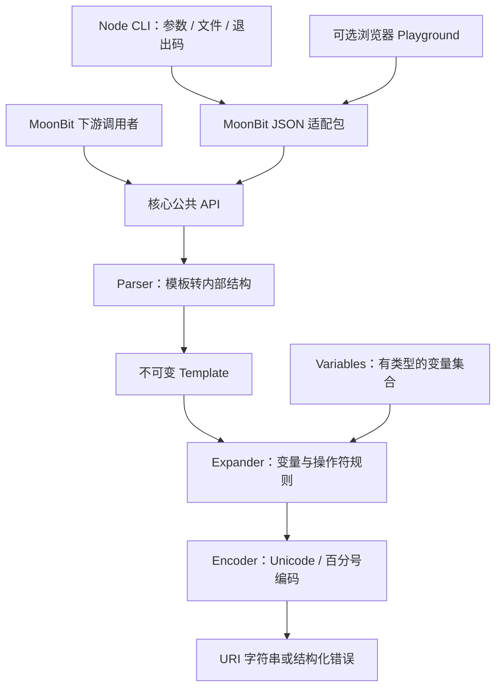

# 项目架构设计

状态：v0.1.0 已实施；公开接口已编译验证。模块名暂用 `cjyhjy/uri_template`，Mooncakes 命名空间待注册确认。

## 1. 总体设计

采用一个 MoonBit 模块。核心库内部按职责拆文件，首版不拆成多个互相依赖的公共包。适配层是独立子包，保证核心库不依赖文件系统、网络、Node.js 或浏览器。



核心使用 MoonBit 及官方标准库，目标是无第三方运行时依赖。JSON 解析优先使用标准库。CLI 采用 JS 编译后端和薄 Node 启动器，Node 只负责参数、文件读取和进程退出，解析、转换和展开都由 MoonBit 完成。JS 导出与错误封送在 M0 做小型技术验证；不能以 JS 重写核心来绕过互操作问题。

## 2. 计划目录

以下为设计时的职责划分；实际目录以仓库为准：公共 parse 位于 parser.mbt，expand 位于 expander.mbt，类型和错误位于 types.mbt。没有为这些职责额外保留空文件。

```text
moon.mod                   模块配置；以锁定工具链生成的格式为准
moon.pkg                   核心库配置
types.mbt                  公开值类型、Variables 和隐藏的 Template
parser.mbt / expander.mbt  parse / expand / variables 公共入口
parser.mbt                 状态机扫描与语法检查
operator.mbt               操作符策略表
encoder.mbt                编码与安全截断
expander.mbt               统一展开引擎
types.mbt                  错误类型、源位置（与值类型同文件）
*_test.mbt                 公共 API 黑盒测试
*_wbtest.mbt               内部实现白盒测试
adapter/json/              JSON -> Variables 与序列化错误
cmd/uri_template/          MoonBit CLI 入口或导出桥接包
tools/cli.mjs              Node 进程边界
tools/generate_fixtures.*  测试数据转换；M0 决定使用可用脚本语言
testdata/upstream/         固定版本的上游夹具及许可证
examples/                  最小调用、API URL、集合参数
docs/                      架构、测试、用户文档、参赛材料
.github/workflows/         选定工具链和测试矩阵
```

MoonBit 当前官方文档采用 `moon.pkg`，更新说明也介绍了 `moon.mod`；不预先套用旧 JSON 配置。以实际安装并固定的工具链为准。[构建工具文档](https://docs.moonbitlang.com/en/stable/toolchain/moon/commands.html)、[官方更新](https://www.moonbitlang.com/updates)

## 3. API 与数据模型

下面概括实际 API；真实 MoonBit 签名见 pkg.generated.mbti，所有模板操作统一返回 TemplateError。

```text
parse(source: String) -> Result<Template, TemplateError>
expand(source: String, variables: Variables) -> Result<String, TemplateError>
Template.expand(variables: Variables) -> Result<String, TemplateError>
Template.variables() -> Array<String>

Value = Scalar(String) | List(Array<String>) | Assoc(OrderedEntries)
Variables = 封装的名称到 Value 的映射
OrderedEntries = 构造时检查键唯一性的有序键值集合
```

接口设计决定：

- `Template` 只通过解析构造，内部结构不可由使用者修改；可反复用于不同变量集合。
- `Variables` 中不存在的键表示未定义；空字符串与空集合保留各自类型。
- 核心只接收字符串及字符串集合；调用者主动决定数字和布尔值的格式。
- `Assoc` 保存插入顺序，重复键在构造时返回错误；避免哈希迭代顺序造成演示和测试不稳定。
- `variables()` 按首次出现顺序去重，返回原始变量名称。
- `expand(source, vars)` 是 `parse` 再 `Template.expand` 的便利组合，两条路径必须等价。
- 默认缺失变量遵循标准省略行为；首版不增加“缺失即报错”的非标准模式。

内部结构：

```text
Template { segments }
Segment = Literal(encoded_text) | Expression(operator, varspecs)
VarSpec { raw_name, modifier, span }
Modifier = None | Prefix(length) | Explode
Span { start_codepoint, end_codepoint }   // 从 0 开始，左闭右开
```

源位置统一采用 Unicode 码点偏移，不泄漏各后端的字符串索引实现。解析器维护单调前进的扫描游标；CLI 根据需要转成从 1 开始的行列号。将来浏览器高亮时显式转换成 DOM 所需的 UTF-16 偏移。

## 4. 解析、编码和展开边界

Parser 使用单次扫描状态机，识别 literal、表达式、变量和修饰符。拒绝不匹配括号、非法变量名、非法修饰符和保留但不支持的操作符。保留原始源区间，成功后才返回完整 Template。

OperatorSpec 记录表达式前缀、项间分隔符、是否输出名称、空值写法与编码模式。Expander 根据“操作符策略 × 值类型 × 修饰符”组合处理，不复制八套完整展开实现。

Encoder 区分模板 literal、普通变量、保留字符展开三条路径。百分号序列的保留/再编码、Unicode 截断和空集合语义是必须单独验证的标准边界；变量名按原始拼写查找。语义依据 [RFC 6570 第 2–3 节](https://www.rfc-editor.org/rfc/rfc6570)，具体回归点见测试文档。

复杂度目标：解析 O(T)；展开 O(R + V + U)，其中 T 是模板长度，R 是变量引用数，V 是实际遍历的输入量，U 是输出长度。使用 builder 避免反复拼接复制；这是设计目标，基准前不宣称已达成。

默认不设置全局缓存，不引入全局可变状态。需要缓存的下游保留 Template 实例即可。

## 5. JSON 和 CLI 契约

首版适配器只接受顶层 JSON object，规则由我们明确设计：

| JSON 输入 | 处理 |
| --- | --- |
| string | Scalar |
| 字符串数组 | List |
| 字符串或 null 值组成的对象 | Assoc；省略 null 成员，键按字典序排序以稳定结果 |
| 顶层变量值 null | 省略变量 |
| number / boolean | 返回带 JSON 路径的类型错误；示例中用字符串明确表示 |
| 嵌套集合、数组内 null 或非字符串 | 返回类型错误，禁止隐式 JSON 字符串化 |

CLI 契约示例（构建后通过 node tools/cli.mjs 运行）：

```sh
uri-template expand '/users/{id}{?page}' --vars '{"id":"42","page":"2"}'
# stdout: /users/42?page=2

uri-template expand '/search{?q,tags*}' --vars-file examples/search.json
uri-template validate '/users/{id}'
uri-template variables '/users/{id}{?page}'
```

`expand` 成功只向 stdout 输出 URI 和换行；诊断到 stderr。退出码：0 成功、1 模板/展开错误、2 参数/JSON/文件错误。`variables` 输出名称 JSON 数组；`validate` 成功输出 `valid`。Shell 示例必须给模板加引号。

核心 API 与上游测试不经过 CLI 的窄类型政策；测试数据中的数字等若出现，在测试适配器按已核查语义转换并明确记录，不以 CLI 类型错误替代标准负例测试。

## 6. 错误与目标平台

错误载荷包含稳定 code、message 和相关 span。解析类如 `UnclosedExpression`、`InvalidVariableName`、`InvalidModifier`；展开类如 `PrefixOnComposite`；适配器另带 JSON 路径。错误消息可改进，测试主要断言 code 和位置。遇到错误不返回看似成功的部分 URI。

核心库必须在 JS 与 wasm-gc 上实际测试；Native 通过同一套测试后再加入支持声明。CLI 首版只声明 Node 环境，浏览器只属于可选适配层。任何后端限制应按包表达，避免 CLI 的环境依赖限制核心库。

## 7. 决策记录

| 决策 | 原因 | 重新评估条件 |
| --- | --- | --- |
| 先库，后演示界面 | 交付核心是可复用生态能力 | 核心验收完成且仍有余量 |
| parse 与 expand 分离 | 支持复用模板和独立诊断 | 保持接口，不引入多余编译层 |
| 单公共核心包 | 防止首版包结构过重 | 出现真实的独立复用需求 |
| 有序 Assoc | 输出稳定，跨后端可验证 | 性能数据证明有瓶颈 |
| 显式错误返回 | 便于 CLI、浏览器和库统一消费 | T02 核实 MoonBit 惯例后固定语法 |
| 标准测试驱动声明 | 防止支持等级和实际行为不一致 | 每次发布重新检查 |

## 实施验证

核心、JSON 适配和示例已在 JS、wasm-gc、Native 通过；Node 桥接只声明 JS。架构边界与原计划一致，JSON 处理使用官方标准库。单引号兼容扩展见 CONFORMANCE.md，真实测试与包导入证据见 ACCEPTANCE.md。
