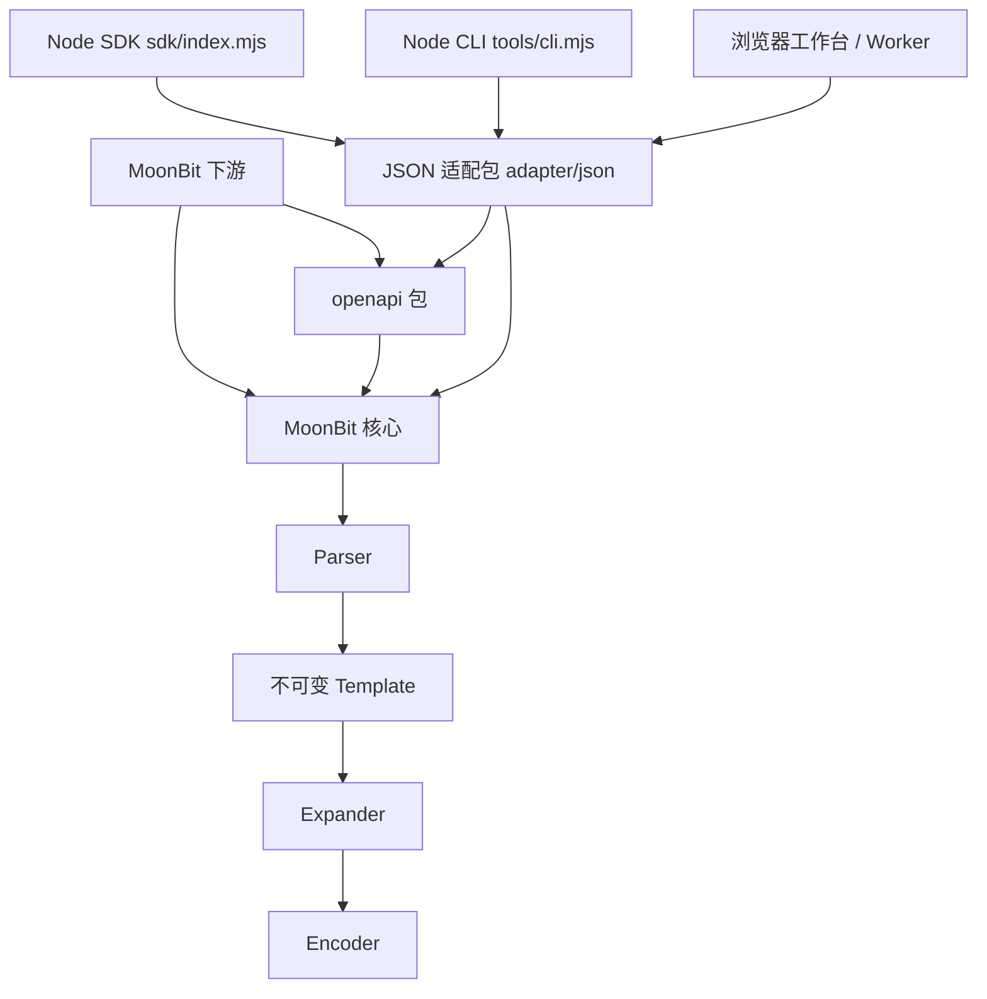

# 架构与测试

## 结构

只有一个 MoonBit 模块。核心不依赖文件系统、网络、Node 或浏览器。JS 侧只处理参数、文件读写、输入快照和位置格式化，解析、编码、展开和预算检查全部在 MoonBit 中完成，编译后放在 `dist/engine.mjs`。

| 文件 | 职责 |
| --- | --- |
| `types.mbt` | 公开值类型、`Variables`、隐藏的 `Template` |
| `parser.mbt` | 单遍扫描，成功才返回完整模板；字面量在解析时预编码 |
| `operator.mbt` | 八种操作符的前缀、分隔符、命名和编码规则表 |
| `encoder.mbt` | UTF-8 百分号编码、前缀截断 |
| `expander.mbt` | 流式展开；`Output` 可只计数不写入，计量与展开走同一路径 |
| `limits.mbt` | 解析与输入预算 |
| `bindings.mbt` | 预检报告、必填与无用绑定检查 |
| `runtime_contract.mbt` | 变量形状契约 |
| `advanced.mbt` | 计量、批量、预绑定、来源映射 |
| `analysis.mbt` / `policy.mbt` | 变量画像、详细差异、静态审计 |
| `catalog*.mbt` | 模板目录、跨模板批量和审计 |
| `link_session.mbt` / `session_bindings.mbt` | 增量链接会话与分块持久存储 |
| `adapter/json/` | JSON 变量转换与请求信封 |
| `sdk/` | Node SDK 与 TypeScript 声明 |
| `openapi/` | OpenAPI 分析：按附录 C 把接口参数合成模板、检查描述、按接口名展开 |
| `sdk/openapi.mjs` | OpenAPI 的 JS 包装：对象快照、冻结和错误封装 |
| `tools/project.mjs` / `tools/openapi.mjs` / `tools/yaml-source.mjs` | 请求配置检查、OpenAPI 命令行（带源位置的 JSON / YAML 读取） |
| `tools/openapi_corpus.mjs` | 200 份公开描述的回归检查 |
| `integrations/moonbit-github/` | 独立 MoonBit 模块：原生 GitHub 客户端，依赖从 Mooncakes 安装 |
| `integrations/github-audit/`、`integrations/public-clients/` | Node 下游客户端 |

## 设计要点

- `Template` 只能通过解析得到，内部结构不对外暴露，可重复使用。没有全局缓存或全局可变状态。
- `Variables::set` 复制集合，调用方事后修改原数组不影响已绑定的值。会话、目录、契约都在构造时复制输入。
- 有界入口会先检查全部输入，再在每次写入前扣减输出预算，不会先构造超限的字符串。
- 源位置一律使用 Unicode 码点；宿主侧另外换算出 UTF-16 偏移和行列。
- 会话把绑定、URI 和长度按 32 个一块存储，更新时只复制改动的块，预算按补丁增量计算。

复杂度：解析 O(T)；展开 O(R + V + U)，其中 T 是模板长度，R 是变量引用数，V 是读取的输入量，U 是输出长度。

## 测试

`npm test`（`tools/verify.py`）依次执行：

1. 格式、接口快照和夹具生成无漂移检查。
2. 四个后端（JS、wasm、wasm-gc、Native）的 MoonBit 测试：270 条上游用例、公共 API、预算、契约、会话、JSON 适配，以及确定性组合测试。
3. Node 测试：SDK、OpenAPI、差分回放、CLI、项目检查、下游客户端（离线）、工作台计算逻辑。
4. TypeScript 声明的正例和预期错误。
5. 打包 npm tarball，在临时空项目中离线安装并运行；用 Mooncakes 源码包建立独立 MoonBit 消费工程，在四个后端运行。

结果写入 `reports/verification.json` 和 `reports/tests-*.log`，记录提交、工具链、源码摘要和逐项统计。

测试原则：

- 预期值来自 RFC、上游用例或外部参考实现，不用被测函数生成。
- 负例必须真正进入解析或展开并失败，适配器崩溃不能算通过。
- 每个修复的问题都要补一条最小回归用例。
- 覆盖率（`python3 tools/coverage.py`）只用来查漏，不设百分比门槛。

## CI

[.github/workflows/ci.yml](../.github/workflows/ci.yml) 运行与本地相同的验收脚本，并上传报告和便携包。
